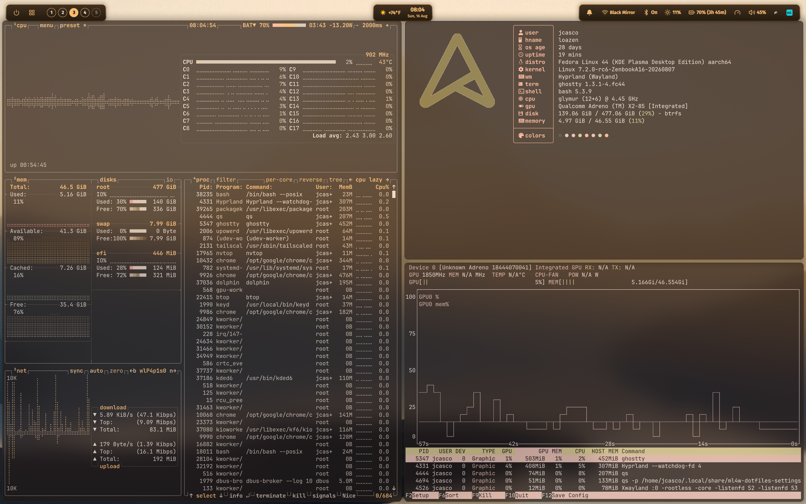

# Linux on the ASUS Zenbook A16 (`UX3607OA`)

**Packaging, kernel delivery, and upstream contributor bridge for the ASUS Zenbook A16 UX3607OA**, powered by Qualcomm Snapdragon X2 Elite Extreme (`glymur`).



## Project Status: Maintenance & Weekly Upstream Sync

Core hardware bringup on the ASUS Zenbook A16 (`UX3607OA`) is **feature-complete on Linux `7.3.6`** (`stable`, package revision 14, promoted default). All primary laptop subsystems—built-in 3K 120 Hz OLED eDP, three simultaneous displays (eDP + HDMI + USB-C DP), HDMI/USB-C DP audio, 4× WSA884x speakers, internal DMICs, hardware video decode/encode (`iris`), RGB + IR cameras with IR emitter, Wi-Fi 7, QCC2072 Bluetooth, Adreno X2 GPU, EC fan control, SCMI `memlat` / SPEL power reporting, USB3, and **full `APSS + CXSD + AOSD + DDR` `s2idle` deep sleep** (without `clk_ignore_unused`, `pd_ignore_unused`, or `glymur_pci_skip=5`)—are working and verified on hardware.

Day-to-day work has moved to **upkeep and maintenance**:
- Checking upstream (`7.3.y` stable, `linux-next`, `qcom-next`, `linux-arm-msm` LKML, and `omacom/omarchy-pkgs`) weekly.
- Retiring local patches as mainline absorbs them and upstreaming remaining clean fixes.
- Building and shipping updated kernel packages for Fedora/Ubuntu A16 users.

Remaining optional/minor items: 3.5 mm WCD9378 headset jack (Qualcomm posted upstream A16 DT wiring on 2026-11-27), USB4 host-router DT nodes, GPU zap shader TrustZone signing (fallback works), syncing the `rc` development track (`7.4-rc`) with `stable`, and monitoring load-correlated USB-C PD-hub resets under heavy draw.

---

## Why This Repository Pivoted: Packaging Layer + Upstream Track

Qualcomm is actively developing Snapdragon X2 (`glymur`) laptop support upstream across [`qcom-next`](https://github.com/qualcomm-linux/kernel/tree/qcom-next), [`laptops-kernel/topic/glymur-laptops`](https://github.com/linux-msm/laptops-kernel), and `linux-arm-msm` on LKML. Instead of maintaining an isolated out-of-tree fork, this repository serves as:

1. **A Distro Packaging & Update Layer**: Delivers side-by-side installable **Fedora RPMs**, **Ubuntu/Debian DEBs**, and portable bundles alongside early-DSP initramfs barriers (`dracut`, `initramfs-tools`), verified DTBs (`qcom,keep-runtime-active;`), ALSA UCM2 / WirePlumber audio routing, DMI-gated power/sleep rules (`90-asus-zenbook-a16-power.rules`, `zenbook-a16-sleep`), and firmware verification tools.
2. **A Two-Track Kernel Bridge (`stable` & `rc`)**:
   - **`stable` ([`kernel/stable/`](kernel/stable/README.md) + [`patches/stable/`](patches/stable/README.md))**: Pinned to **Linux `v7.3.6`** (`1a0388846138eda9f6eb4258ff227a223afc2f52`) with 183 residual backported and local patches (`a25b51b1ceda63f568d36f0dd4847c0787dfcfaa`). Aligned with **`linux-omarchy 7.3.6`** and Fedora 45 ARM `7.3.6`.
   - **`rc` ([`kernel/rc/`](kernel/rc/README.md) + [`patches/rc/`](patches/rc/README.md))**: Pinned to **Linux `v7.4-rc1` `linux-next` (`next-20261103`, `d6bcfc94eb4da6e089c5473970cd96727292fd97`)** with 114 residual patches (`ae9780ba94c73237250a58ecc44fca2485813f8a`). Used for validating LKML series and tracking `linux-next` (pending sync with `stable` rev 12–14 additions).

---

## Quick Start: Install, Upgrade, or Build

### 1. Build Kernel Packages (`RPM`, `DEB`, or Portable Bundle)

Supply any Linux Git repository containing the pinned base commit (`v7.3.6` for `stable`, `next-20261103` / `v7.4-rc1` for `rc`):

```sh
# Replay and verify both tracks in a temporary Git index (no checkout changes):
python3 scripts/ci.py --replay-only --track both --linux-git /path/to/linux.git

# Build the Linux 7.3.6 Stable Track (Fedora RPMs + portable bundle):
JOBS=4 PACKAGE_REVISION=14 ./kernel/stable/build.sh /path/to/linux.git /path/to/stable-out

# Build Ubuntu/Debian DEBs instead:
JOBS=4 PACKAGE_REVISION=14 BUILD_RPM=0 BUILD_DEB=1 \
  ./kernel/stable/build.sh /path/to/linux.git /path/to/stable-deb-out

# Build the RC Development Track:
JOBS=4 PACKAGE_REVISION=6 ./kernel/rc/build.sh /path/to/linux.git /path/to/rc-out
```

If a build is interrupted, pass `--resume` before `/path/to/linux.git` to reuse the verified worktree and compiled objects. Every package revision appends `-a16pkgN+` to the kernel release so upgrades install side-by-side and never overwrite your running or rollback kernel.

### 2. Install or Upgrade on Fedora / Ubuntu

> **Note for Omarchy users:** Do not install these Fedora/Ubuntu packages on Omarchy—use the published `linux-omarchy`, `linux-omarchy-dtbs`, `asus-zenbook-a16-firmware`, and `asus-zenbook-a16-support` packages instead ([status](docs/omarchy-status.md)).

Build and install on native aarch64 Linux; the [package contract](packaging/zenbook-a16-kernel/README.md) lists the build tools. Each build emits three packages that must be installed together (`zenbook-a16-support`, the versioned kernel payload `kernel-zenbook-a16-*` / `linux-image-*`, and the tracking package `zenbook-a16-kernel`):

```sh
# 1. Check that the board firmware is present (see firmware/README.md for sources):
sudo ./iso/glymur-fetch-firmware.sh --check

# 2. Install all three packages together (Fedora):
sudo dnf install /path/to/stable-out/bundle/rpms/*.rpm

# Or on Ubuntu/Debian:
sudo apt install /path/to/stable-deb-out/bundle/debs/*.deb
```

What the install does and does not do:

- The new kernel is added beside the existing ones under its own `-a16pkgN+` release. **The boot default is not changed**; pick the new entry by hand for the first boot and keep the old one as rollback.
- Packaged A16 boot entries use the clean `7.3.6` command line (`cma=128M`, `selinux=0`, `asus_glymur_ec.fan_profile=2`; legacy `clk_ignore_unused`, `pd_ignore_unused`, and `glymur_pci_skip=5` are retired). `zenbook-a16-support` stages DMI-gated `90-asus-zenbook-a16-power.rules` and `zenbook-a16-sleep` for `s2idle` deep sleep.
- Nothing is signed for Secure Boot, `selinux=0` remains set, and no binary package repository is published yet, so updates mean building and installing a new revision.

For a fresh installation from live media, or to add the kernel-update hooks to an existing root:

```sh
# Full disk installation from live media, after the distro installer has finished:
sudo iso/zenbook-install-to-disk.sh /mnt

# Install persistent kernel-update hooks into a running root or mounted target:
sudo packaging/zenbook-a16-hooks/install-hooks.sh --root / --distro auto
sudo /usr/lib/zenbook-a16/activate-hardware
```

See the [Fedora/Ubuntu installation guide](iso/README.md), [package contract](packaging/zenbook-a16-kernel/README.md), and [Omarchy status](docs/omarchy-status.md).

For openSUSE, Michi ([@scalpel4k](https://github.com/scalpel4k)) maintains an [A16 installer](https://build.opensuse.org/package/show/home:scalpel4k:branches:systemsmanagement:Agama:Release/agama-installer) and [kernel package](https://src.opensuse.org/scalpel4k/kernel-qcom-laptops). It builds on these patches and adds fixes of its own.

---

## Repository Layout

| Path | Purpose |
|---|---|
| [`kernel/stable/`](kernel/stable/README.md) | **Stable Release Track (`v7.3.6`)**: `build.sh`, `replay.py`, `build.json`, Kconfig (`config`, `required.config`), and `SHA256SUMS`. |
| [`patches/stable/`](patches/stable/README.md) | **Stable Patch Queue (183 patches)**: Ordered `git format-patch` series for `v7.3.6` plus [`port-map.json`](patches/stable/port-map.json) tracking upstream equivalents. |
| [`kernel/rc/`](kernel/rc/README.md) | **RC / Upstream Development Track (`v7.4-rc1` / `next-20261103`)**: `build.sh`, `replay.py`, `build.json`, Kconfig (`config`, `required.config`), and `SHA256SUMS`. |
| [`patches/rc/`](patches/rc/README.md) | **RC Patch Queue (114 patches)**: Ordered `git format-patch` series for `next-20261103` (`d6bcfc94eb4da6e089c5473970cd96727292fd97`) plus [`port-map.json`](patches/rc/port-map.json). |
| [`kernel/arch-7.2.10/`](kernel/arch-7.2.10/BUILD-AND-UPGRADE.txt) | **Legacy Arch Linux 7.2.10 Recipe**: Retained `PKGBUILD` generator with side-by-side UKI and header support. |
| [`packaging/`](packaging/zenbook-a16-kernel/README.md) | Distro packager ([`zenbook-a16-kernel/`](packaging/zenbook-a16-kernel/README.md)), shared post-install hooks and boot/initramfs verifiers ([`zenbook-a16-hooks/`](packaging/zenbook-a16-hooks/)), and Arch/Omarchy packaging ([`omarchy-a16-support/`](packaging/omarchy-a16-support/)). |
| [`iso/`](iso/README.md) | Live image builder (`build-live-images.sh`), disk installer (`zenbook-install-to-disk.sh`), and firmware presence check and copy helper (`glymur-fetch-firmware.sh`). |
| [`tweaks/`](tweaks/) | UX3607OA ALSA UCM2 profiles, WirePlumber rules, power/sleep udev & `systemd-sleep` hooks, `libcamera` IPA tuning, and CPU frequency profiles (`glymur-cpu-profile.sh`). |
| [`firmware/`](firmware/README.md) | Required Qualcomm/ASUS firmware manifest and upstream AudioReach topology build/verifier (no proprietary blobs are stored in Git). |
| [`scripts/`](scripts/ci.py) | Hardware-free CI runner (`ci.py`), disposable KVM guest harness (`ci-vm.sh`), and runtime triage utilities (`scripts/triage/`). |
| [`archive/`](archive/README.md) | Retired bringup snapshots (`rc3-20260919`, `rc5-20261002`, `rc5-20261008`, `rc5-20261013`, `rc5-20261031`, `next-202608*`) and historical standalone patches. |

---

## Upstream Contributions & LKML Tracking

A core goal of this repository is contributing back to mainline Linux (`Author:`, `Tested-by:`, and `Reviewed-by:` on `linux-arm-msm` / LKML) and validating upstream Snapdragon X2 (`glymur`) series on real UX3607OA hardware. Full commit-level provenance is recorded in [`UPSTREAM-CREDITS.md`](UPSTREAM-CREDITS.md).

### Upstreamed & Submitted Fixes (Jesse Casco)

- **Merged / Applied upstream**:
  - `drm/msm/dp: skip PUSH_IDLE when the link was never enabled` — merged in mainline Linux `7.3` (`e249a6e2a130`), backported to `6.18.54` / `7.2.8`.
  - `regulator: qcom-rpmh: Don't overwrite the initial mode with the boot readback` (`0144`) — applied by Mark Brown (`2026-11-17`).
  - `media: qcom: camss: x1e80100: Use the lite clocks for the lite CSIDs` (`0159`) — applied by Bryan O'Donoghue (`2026-11-26`).
  - `Bluetooth: hci_qca: Add M.2 pwrseq support` (`monza-wireless` v9 1/8, `0153`, carrying `Tested-by:`) — applied to `bluetooth-next` (`7fea07497112`).
- **Reviewed / On LKML**:
  - `drm/msm/dp` eDP 1.4 `LINK_RATE_SET` 2-patch series (`0001`, `0147`–`0149`) — `Reviewed-by: Dmitry Baryshkov` (`2026-11-27`).
  - `drm/msm/dpu: link Glymur layer mixers 4-7 to DSPPs 4-7` (`0198`) — sent `2026-11-27` (`20261127210857.65336-1-jesse.casco@gmail.com`).
  - `drm/msm/dp` eDP link-training fallback bandwidth floor (`0158`) — sent `2026-11-14` (`20261115000021.78869-1-jesse.casco@gmail.com`; also merged in `omacom/omarchy-pkgs#3628`).
  - `clk: qcom: gdsc: unwind domains when registration fails` (`0112`), `rtc: interface` wakeup-source leak (`0145`), and `rtc: qcom-glink` read-only ops (`0146`) — sent to LKML.
- **Local / board-specific carries** (`patches/stable/`):
  - `HID: asus` Zenbook A16 keyboard & backlight (`0004`), `q6apm` SPF fast-retry (`0011`), SoundWire `qcom,keep-runtime-active` (`0058`), M.2 Wi-Fi/BT wiring (`0154`), RGB MCLK4 6 mA (`0155`), 7.3 `hm1092` `.set_fmt` (`0156`), PMH0101 IR emitter (`0157`), HDMI HPD on `&mdss_dp2` (`0170`), `iris` timeout firmware reload (`0201`), and A16 DP/HDMI audio DAI links (`0203`, superseded upstream by Srinivas Kandagatla's `v2 6/7` posted `2026-11-27`).
  - Older combined snapshots (`0028`, `0050`–`0061`, `0104`–`0111`) remain local carries as individual fixes continue landing upstream.

### Tracked Qualcomm, LKML & Community Patches Carried in `stable`

- **Full `s2idle` deep sleep & power management** (*Akhil P Oommen*, *Brandon Williams*, *Birk Skyum*, *David Heinemeier Hansson / Omarchy*, *Abel Vesa*): PM hibernation/sleep fixes (`0140`–`0142`), `scmi-qcom-memlat` `polling_ms = 0` (`0204`), `cluster_cl5` 1000 s s2idle-only guard (`0205`), A16 `switch-lid` wakeup fix (`0206`), Adreno GMU platform driver (`0207`–`0212`), and broken QCE crypto disable (`0213`).
- **Glymur DP PHY v8 & external displays** (*Ritesh Kumar*, *Saurabh Anand*, *Yongxing Mou*, *Konrad Dybcio*, *Michi (@scalpel4k)*): DP PHY v8 PLL/programming series (`0162`–`0169`), Type-C mux delay & DP sink-request guard (`0176`–`0177`), `pmic_glink_altmode` non-USB4/orientation fixes, `ucsi_glink` mux quirk, QMP combo DP/USB3 mode switching, and `aux-hpd` boot-time replay (`0183`–`0189`).
- **Hardware video (`iris`), SCMI `memlat`, SPEL, firmware declarations & USB/Wi-Fi resume** (*Michi (@scalpel4k)*, *Filippo Falezza*, *Joonhoe Kim*, *Tapas Rana*, *Prashanth K*, *Krishna Kurapati*, *Wangao Wang*, *Vishnu Reddy*): `MODULE_FIRMWARE` declarations and `hid-asus` `fnlock_default` (`0171`–`0175`), Qualcomm `qcom-7.3` `iris` / `memlat` / `SPEL` backports (`0178`–`0182`), `dwc3-qcom` / `m31-eusb2` / `ath12k` fixes (`0190`–`0197`), and `iris` suspend deadlock and output-buffer-count fixes (`0199`, `0202`).
- **USB3, EC, AudioReach, PCIe, Camera & QCC2072 BT** (*Konrad Dybcio*, *Zhangfei Gao*, *Fabian Renn-Giles*, *Oleg Keri*, *Qiang Yu*, *Mrinmay Sarkar*, *Nihal Kumar Gupta*, *Bryan O'Donoghue*, *Rahul Samana*, *Vivek Sahu*, *Krishna Chaitanya Chundru*, *Manivannan Sadhasivam*): `0143` USB3 PHY, `0023`–`0025` EC, `0114`–`0115`/`0121`/`0131`–`0132` audio, `0048`–`0049`/`0089` PCIe, `0100`–`0109`/`0159`–`0161` cameras, and `0150`–`0153` QCC2072 Bluetooth (`FROMLIST`).

---

## Hardware Status Summary

See [`docs/current-build.md`](docs/current-build.md) and [`docs/omarchy-status.md`](docs/omarchy-status.md) for per-boot hardware evidence and remaining limits:

| Subsystem | Status on `stable` (`v7.3.6`) |
|---|---|
| **Boot, NVMe & Btrfs** | **Working**: early-DSP (`qcadsp8480.mbn`, `qccdsp8480.mbn`) pre-root initramfs barrier (`pre-root-v1`), clean cmdline without `clk_ignore_unused`/`pd_ignore_unused`/`glymur_pci_skip=5`. |
| **Built-in 3K OLED eDP Display** | **Working**: native 2880x1800 @ 120 Hz (`phy-qcom-edp` v8 + `drm/msm/dp` `LINK_RATE_SET` and eDP fallback fixes). |
| **External Displays (HDMI / USB-C DP)** | **Working**: 3 simultaneous displays (`eDP-1` 2880x1800@120 + `HDMI-A-1` 1920x1080@60 + `DP-1` 1920x1080@120) from power-on and across DPMS cycles (`0162`–`0170`, `0176`–`0177`, `0183`–`0189`, `0198`). |
| **Hardware Video Codec (`iris`)** | **Working**: bit-exact H264/HEVC/VP9 decode (60/60 GStreamer), H264 encode (20/20 FFmpeg), and 5/5 forced firmware-hang recovery with clean runtime suspend (`0178`–`0179`, `0199`, `0201`–`0202`). |
| **Speakers, DMICs & HDMI/DP Audio** | **Working**: 4× WSA884x speakers (`MM1`), internal DMICs (`MM2`), and HDMI/USB-C DP audio (`MM3`/`MM4`/`MM7` via `0203` + UCM `HDMI0`/`1`/`2` + scoped WirePlumber rules) on upstream `audioreach-topology` (`31eaaac0`). 3.5 mm WCD9378 headset jack pending upstream `v2 5/7`. |
| **Cameras (OV02C10 RGB / HM1092 IR)** | **Working**: full X1E80100 CSID/VFE tables (`0159`–`0161`), 6 mA RGB MCLK4 (`0155`), ganged PMH0101 IR emitter (`0157`), and `libcamera` `simple` IPA black-level tuning. |
| **Keyboard, Backlight & Touchpad** | **Working**: `hid-asus` UX3607OA I2C HID feature reports (`fnlock_default` via `0175`) and `i2c_hid_of`. |
| **Wi-Fi 7 & Bluetooth (QCC2072)** | **Working**: mainline M.2 connector (`0150`–`0154`), `board-2.bin`/`firmware-2.bin`, and `linux-firmware` `qca/orn*`; both survive full `s2idle` CX collapse cleanly. |
| **Power, EC Fan & `s2idle` Deep Sleep** | **Working**: USB-PD, `asus_glymur_ec` fan profile 2, `scmi-qcom-memlat` (`polling_ms = 0`, 0 idle mbox IRQs), `SPEL`, `cluster_cl5` 1000 s runtime guard, and **full `APSS + CXSD + AOSD + DDR` `s2idle` collapse** (97.7% residency verified on `loazen`, clean NVMe/Wi-Fi/BT/speaker resume via `90-asus-zenbook-a16-power.rules` + `zenbook-a16-sleep`). |
| **USB-C / USB3 (`usb0`, `usb1`)** | **Working**: `0143` + `0176`/`0187`/`0188` SuperSpeed verified; USB4 host-router DT nodes and heavy-load VIA PD-hub resets remain open. |

## Reference

- [Kernel Track Policy & Lifecycle](docs/kernel-tracks.md) and [Current Build Record](docs/current-build.md)
- [Kernel Packages Overview](kernel/README.md) and [Patch Queues Overview](patches/README.md)
- [Upstream Credits & Provenance](UPSTREAM-CREDITS.md) and [Changelog](CHANGELOG.md)
- [Hardware Architecture](docs/hardware.md) and [Power & Thermal Notes](docs/power-and-thermal.md)

Kernel-derived sources and patches are **GPL-2.0-only**; see [LICENSE](LICENSE). Unofficial community packaging and kernel engineering project, not endorsed by ASUS or Qualcomm.
