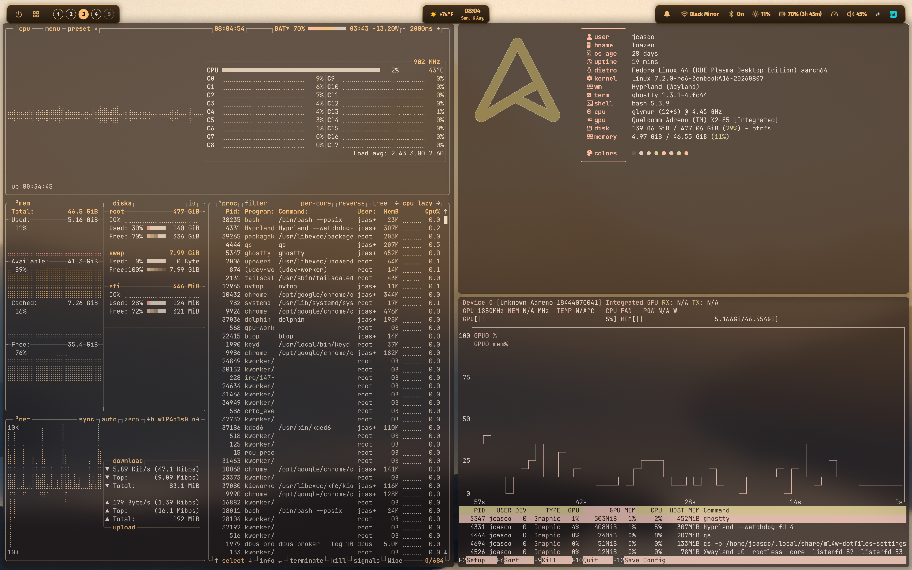

# Linux on the ASUS Zenbook A16 (`UX3607OA`)

**Packaging, kernel delivery, and upstream contributor bridge for the ASUS Zenbook A16 UX3607OA**, powered by Qualcomm Snapdragon X2 Elite Extreme (`glymur`).



## Why This Repository Pivoted: Packaging Layer + Upstream Track

Qualcomm is now actively developing Snapdragon X2 (`glymur`) laptop support upstream across [`qcom-next`](https://github.com/qualcomm-linux/kernel/tree/qcom-next), [`laptops-kernel/topic/glymur-laptops`](https://github.com/linux-msm/laptops-kernel), and `linux-arm-msm` on LKML. Instead of maintaining an isolated out-of-tree fork, this repository serves as:

1. **A Distro Packaging & Update Layer**: Delivers side-by-side installable **Fedora RPMs**, **Ubuntu/Debian DEBs**, **Arch / Omarchy PKGBUILDs**, and portable bundles alongside early-DSP initramfs barriers (`dracut`, `initramfs-tools`, `mkinitcpio`), verified DTBs (`qcom,keep-runtime-active;`), ALSA UCM2 / WirePlumber audio routing, and owner-extracted board firmware.
2. **A Two-Track Kernel Bridge (`stable` & `rc`)**:
   - **`stable` ([`kernel/stable/`](kernel/stable/README.md) + [`patches/stable/`](patches/stable/README.md))**: Pinned to **Linux `v7.3` final** (`c03c1a14507dfaf8b856c2608f9ac216021fc222`) with 146 backported and local patches (`ca55d57edf4c0c2ade677f0b5336e69ab8645c3a`). Directly aligned with **`linux-omarchy 7.3`** so patches validated on `stable` ship to both standalone Fedora/Ubuntu users and Omarchy.
   - **`rc` ([`kernel/rc/`](kernel/rc/README.md) + [`patches/rc/`](patches/rc/README.md))**: Pinned to **Linux `v7.4-rc1` `linux-next` (`next-20261103`, `d6bcfc94eb4da6e089c5473970cd96727292fd97`)** with 103 residual patches (`e52a4f3ca29b6348ecaf84a4f349bde8d0cc1fb7`) after retiring 45 upstreamed patches from the `7.3` stable queue ([`patches/rc/port-map.json`](patches/rc/port-map.json)). Used for validating LKML series (`Tested-by:` / `Reviewed-by:`), staging local contributor fixes before upstream submission, and tracking `qcom-next` / `linux-next`.

---

## Quick Start: Install, Upgrade, or Build

### 1. Build Kernel Packages (`RPM`, `DEB`, or Portable Bundle)

Supply any Linux Git repository containing the pinned base commit (`v7.3` for `stable`, `next-20261103` / `v7.4-rc1` for `rc`):

```sh
# Replay and verify both tracks in a temporary Git index (no checkout changes):
python3 scripts/ci.py --replay-only --track both --linux-git /path/to/linux.git

# Build the Linux 7.3 final Stable Track (Fedora RPMs + portable bundle):
JOBS=4 PACKAGE_REVISION=1 ./kernel/stable/build.sh /path/to/linux.git /path/to/stable-out

# Build Ubuntu/Debian DEBs instead:
JOBS=4 PACKAGE_REVISION=1 BUILD_RPM=0 BUILD_DEB=1 \
  ./kernel/stable/build.sh /path/to/linux.git /path/to/stable-deb-out

# Build the RC Development Track:
JOBS=4 PACKAGE_REVISION=1 ./kernel/rc/build.sh /path/to/linux.git /path/to/rc-out
```

If a build is interrupted, pass `--resume` before `/path/to/linux.git` to reuse the verified worktree and compiled objects. Every package revision appends `-a16pkgN+` to the kernel release so upgrades install side-by-side and never overwrite your running or rollback kernel.

### 2. Install or Upgrade on Fedora / Ubuntu

Each build emits three coordinated packages (`zenbook-a16-support`, the versioned kernel payload `kernel-zenbook-a16-*` / `linux-image-*`, and the tracking meta-package `zenbook-a16-kernel`):

```sh
# 1. Verify or extract owner-supplied board firmware from the Windows partition:
sudo ./iso/glymur-fetch-firmware.sh --check

# 2. Install all three packages together (Fedora):
sudo dnf install /path/to/stable-out/bundle/rpms/*.rpm

# Or on Ubuntu/Debian:
sudo apt install /path/to/stable-deb-out/bundle/debs/*.deb
```

To install persistent post-install hooks, hardware activation rules, or perform a full disk installation from live media:

```sh
# Install persistent kernel-update hooks into a running root or mounted target:
sudo packaging/zenbook-a16-hooks/install-hooks.sh --root / --distro auto
sudo /usr/lib/zenbook-a16/activate-hardware

# Full disk installation from live media:
sudo iso/zenbook-install-to-disk.sh /mnt
```

See the [Fedora/Ubuntu installation guide](iso/README.md), [package contract](packaging/zenbook-a16-kernel/README.md), and [Omarchy status](docs/omarchy-status.md).

---

## Repository Layout

| Path | Purpose |
|---|---|
| [`kernel/stable/`](kernel/stable/README.md) | **Stable Release Track (`v7.3` final)**: `build.sh`, `replay.py`, `build.json`, Kconfig (`config`, `required.config`), and `SHA256SUMS`. |
| [`patches/stable/`](patches/stable/README.md) | **Stable Patch Queue (146 patches)**: Ordered `git format-patch` series for `v7.3` final plus [`port-map.json`](patches/stable/port-map.json) tracking upstream equivalents. |
| [`kernel/rc/`](kernel/rc/README.md) | **RC / Upstream Development Track (`v7.4-rc1` / `next-20261103`)**: `build.sh`, `replay.py`, `build.json`, Kconfig (`config`, `required.config`), and `SHA256SUMS`. |
| [`patches/rc/`](patches/rc/README.md) | **RC Patch Queue (103 patches)**: Ordered `git format-patch` series for `next-20261103` (`d6bcfc94eb4da6e089c5473970cd96727292fd97`) plus [`port-map.json`](patches/rc/port-map.json) recording 45 retired upstream commits. |
| [`kernel/arch-7.2.10/`](kernel/arch-7.2.10/BUILD-AND-UPGRADE.txt) | **Arch Linux 7.2.10 Recipe**: Reproducible `PKGBUILD` generator with side-by-side UKI and header support. |
| [`packaging/`](packaging/zenbook-a16-kernel/README.md) | Distro packager ([`zenbook-a16-kernel/`](packaging/zenbook-a16-kernel/README.md)), persistent post-install hooks ([`zenbook-a16-hooks/`](packaging/zenbook-a16-hooks/)), and boot/initramfs verifiers ([`omarchy-a16-support/`](packaging/omarchy-a16-support/)). |
| [`iso/`](iso/README.md) | Live image builder (`build-live-images.sh`), disk installer (`zenbook-install-to-disk.sh`), and Windows firmware extractor (`glymur-fetch-firmware.sh`). |
| [`tweaks/`](tweaks/) | UX3607OA ALSA UCM2 profiles, WirePlumber rules, CPU frequency profiles (`glymur-cpu-profile.sh`), and suspend/resume guards. |
| [`firmware/`](firmware/README.md) | Required Qualcomm/ASUS firmware manifest and topology documentation (no proprietary blobs are stored in Git). |
| [`scripts/`](scripts/ci.py) | Hardware-free CI runner (`ci.py`), disposable KVM guest harness (`ci-vm.sh`), and runtime triage utilities (`scripts/triage/`). |
| [`archive/`](archive/README.md) | Retired bringup snapshots (`rc3-20260919`, `rc5-20261002`, `rc5-20261008`, `rc5-20261013`, `rc5-20261031`, `next-202608*`) and historical standalone patches. |

---

## Upstream Contributions & LKML Tracking

A core goal of this repository is contributing back to mainline Linux (`Author:`, `Tested-by:`, and `Reviewed-by:` on `linux-arm-msm` / LKML) and validating upstream Snapdragon X2 (`glymur`) series on real UX3607OA hardware. Full commit-level provenance is recorded in [`UPSTREAM-CREDITS.md`](UPSTREAM-CREDITS.md).

### Authored & Submitted Fixes in This Stack (Jesse Casco)

- **DisplayPort eDP 1.4 Link Training**: `drm/msm/dp: make the eDP 1.4 LINK_RATE_SET path actually take effect` and `drm/msm/dp: clear PUSH_IDLE before starting the pixel stream` (`patches/stable/0001`, `0111`).
- **Qualcomm GDSC Error-Unwind RFC**: `clk: qcom: gdsc: unwind genpd registration on provider failure` (`patches/stable/0112`, posted to LKML).
- **Audio & SoundWire Stability**: `ASoC: codecs: wsa884x: keep runtime PM balanced across SoundWire enumeration`, `soundwire: qcom: supportqcom,keep-runtime-active for ADSP-backed controllers`, and `soc: qcom: apr: wait for audio PDR services before registering children`.
- **ASUS Zenbook A16 Input & Platform**: `HID: asus: complete the feature set for the Zenbook I2C keyboard/backlight` (`0004`), `platform/arm64: asus-glymur-ec: add fan profile and thermal sensor driver`, and `usb: typec: ucsi: glink: drain pending notifications on teardown`.

### Tracked Qualcomm & LKML Series Integrated in `stable` (`0112`–`0143`)

- **USB3 QMP Combo PHY Calibration** (*Konrad Dybcio*, Oct 27 2026): `phy: qcom: qmp-combo: Update Glymur USB3 settings` (`0143`).
- **USB3-DP PHY & DisplayPort HPD** (*Abel Vesa*): `phy: qcom-qmp-combo: Fix register base for USB3-DP PHY on Glymur` (`0121`) and `drm/msm/dp: Fix internal HPD handling on hotplug init` (`0122`).
- **AudioReach & LPASS Multichannel / Clock Fixes** (*Neil Armstrong*, *Srinivas Kandagatla*, *Zhangfei Gao*): `ASoC: qcom: audioreach: use q6dsp_map_channels()` (`0114`–`0115`) and `ASoC: codecs: lpass-*-macro: Fix bulk clock allocations` (`0132`–`0136`).
- **PCIe D3cold & Endpoint PERST# Lifecycle** (*Manivannan Sadhasivam*, *Qiang Yu*): `PCI: qcom: Keep the PCIe link in L0 during suspend if endpoint lacks D3cold` (`0125`–`0128`).
- **Camera CCI, PM8010 & HM1092 Sensor Stack** (*Oleg Keri*, *Hitesh Patel*, *Loic Poulain*, *Ramshouriesh R*, *Jake Steinman*, *Konrad Dybcio*): Integrated in `0102`–`0110` and `0137`–`0139`.

---

## Hardware Status Summary

See [`docs/current-build.md`](docs/current-build.md) and [`docs/omarchy-status.md`](docs/omarchy-status.md) for per-boot hardware evidence and remaining limits:

| Subsystem | Status on `stable` / `rc` |
|---|---|
| **Boot, NVMe & Btrfs** | Verified with early-DSP (`qcadsp8480.mbn`, `qccdsp8480.mbn`) pre-root initramfs barrier (`pre-root-v1`). |
| **Built-in 3K OLED eDP Display** | Working at native 2880x1800 @ 120 Hz (`phy-qcom-edp` v8 + `drm/msm/dp` `LINK_RATE_SET` and `PUSH_IDLE` fixes). |
| **Keyboard, Backlight & Touchpad** | Working via `hid-asus` UX3607OA I2C HID feature reports and `i2c_hid_of`. |
| **Wi-Fi 7 (`ath12k` QCC2072)** | Working with board-specific `board-2.bin` / `firmware-2.bin`. |
| **Speakers (4x WSA884x SoundWire)** | Working with `qcom,keep-runtime-active;` DTB guard and UX3607OA topology/UCM2. |
| **Camera (HM1092 RGB/IR) & DMICs** | Integrated (`camera_enabled: true`, nonsecure CSID0/VFE0 path, AudioReach channel-map clearing, 4 mA/slew-1 DMIC pins); simultaneous cold-boot acceptance in progress. |
| **USB-C / USB3 (`usb0`, `usb1`)** | `0143` updates Glymur USB3 QMP combo PHY SERDES/TX/RX/PCS tables for `usb1` `-71` SuperSpeed link training; physical port matrix acceptance in progress. |
| **Power, EC Fan & Sleep** | USB-PD online and `asus_glymur_ec` fan profile 2 active; deep S2idle/PCIe noirq suspend remains guarded (`glymur_pci_skip=5`). |

## Reference

- [Kernel Track Policy & Lifecycle](docs/kernel-tracks.md) and [Current Build Record](docs/current-build.md)
- [Kernel Packages Overview](kernel/README.md) and [Patch Queues Overview](patches/README.md)
- [Upstream Credits & Provenance](UPSTREAM-CREDITS.md) and [Changelog](CHANGELOG.md)
- [Hardware Architecture](docs/hardware.md) and [Power & Thermal Notes](docs/power-and-thermal.md)

Kernel-derived sources and patches are **GPL-2.0-only**; see [LICENSE](LICENSE). Unofficial community packaging and kernel engineering project, not endorsed by ASUS or Qualcomm.
