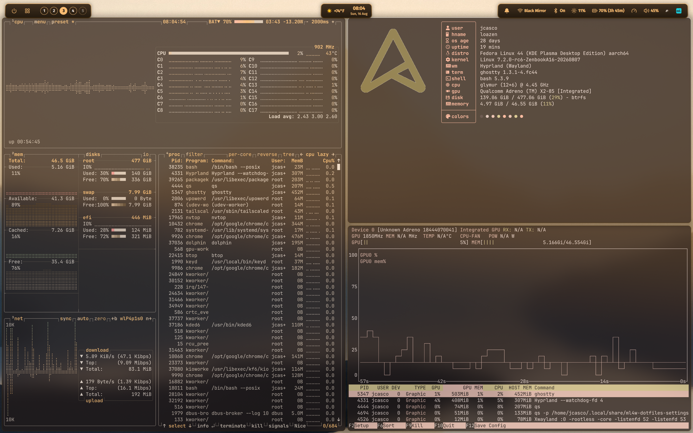

# Linux on the ASUS Zenbook A16

Mainline-based Linux bring-up for the **ASUS Zenbook A16 UX3607OA**, powered by
Qualcomm Snapdragon X2 Elite Extreme (`glymur`).



## Baseline — 2026-10-14

**`7.3.0-rc5-ZenbookA16-20261013-rc5-soc2+` is the repository and future-testing
baseline.** This is a development baseline with limited hardware acceptance.

The [build package](kernel/rc5-20261013/README.md) contains the exact tested
config and [64 ordered patches](patches/rc5-20261013/README.md). The previous
59 patches are unchanged; five additions cover error handling, DMA, SoundWire,
Bluetooth, DP, QMP/Type-C ownership and a hibernation config fragment.

| Area | Validation and limits |
|---|---|
| Boot and storage | Ordinary soc2 boot verified; 8,487 installed hashes match. The earlier Btrfs free-space-cache error has not returned after cache rebuild. |
| Display and input | Built-in display, keyboard and touchpad confirmed on the preceding boot of the same binaries. |
| Speakers | Four channels confirmed on an earlier soc2 boot; accepted with the retained keep-active workaround. All four devices are attached now; no fresh listening test. |
| CPU and GPU | One 30-second CPU worker and 600 Vulkan frames passed on the preceding boot. Long-duration stability remains open. |
| Wi-Fi and USB0 | Wi-Fi passed 20 gateway replies on this boot; USB0 SuperSpeed Ethernet passed a short test on an earlier soc2 boot. |
| USB1 | SuperSpeed enumeration still fails with `-71`; the hub falls back to USB2. |
| Bluetooth | Missing `qca/clnbtfw10.tlv` is reported; pairing and traffic remain unvalidated. |
| Power and sleep | USB-PD supply is online; fan profile 2 is selected. Suspend, hibernate, battery life and physical fan response remain unaccepted. |
| Other hardware | Camera capture, microphones, other audio routes, external displays and USB4 remain unvalidated. Camera drivers are blacklisted. |

The [current build record](docs/current-build.md) separates current-boot checks
from retained tests. Historical resets and RPMh timeouts remain unresolved.
The saved GRUB fallback remains `zenbook-a16-rc5-audiopm1-fan2-20261008`;
previous kernels and the Windows route are retained.

## Branches & Distro Tracks

All cross-compatible kernel tracks, multi-distro installer scripts, and persistent kernel-update hooks are synced to `main`, with dedicated working branches for concurrent development:

- **`main`**: Unified baseline carrying the mainline `7.3-rc5` (`rc5-20261013`) and Arch `7.2.10` (`arch-7.2.10`) kernel packages, cross-distro installer (`iso/`), and persistent kernel-update hooks (`packaging/`).
- **`feature/multi-distro-installer`**: Working branch for the cross-distro installer, kernel builder (`RPM`/`DEB`/bundle), and persistent kernel-update hooks across Fedora (`aarch64`), Ubuntu (`arm64`), and Arch Linux (`aarch64`).
- **`feature/arch-7.2.10-a16`**: Working branch for the Arch Linux / Omarchy `7.2.10` kernel & support package port (contributing to the Omarchy `dragon` / `quattro` / `feature/asus-zenbook-a16` branches).

## Build and test

Build the tested kernel baseline and generate distro packages or a portable bundle:

```sh
python3 kernel/rc5-20261013/verify.py /path/to/linux
JOBS=4 ./kernel/rc5-20261013/build.sh /path/to/linux /path/to/new-output
```

Build options are configured via environment variables:
- `BUILD_RPM=1`: Build Fedora-installable RPMs via `binrpm-pkg` (default: 1).
- `BUILD_DEB=1`: Build Ubuntu/Debian-installable DEBs via `bindeb-pkg` (default: 0).
- `STAGE_BUNDLE=1`: Stage portable distro-agnostic bundle at `$OUTPUT_DIR/bundle/` containing `vmlinuz-$KREL`, `glymur-asus-zenbook-a16-ux3607oa.dtb`, `lib/modules/$KREL/`, ABI markers, and release metadata (default: 1).

The build script automatically validates the compiled DTB against the required `qcom,keep-runtime-active;` safety property via `dtc`, aborting the build if missing.

## Installation & Persistent Kernel Hooks

To install the kernel, DTB, firmware, platform tweaks, and persistent update hooks onto a target system:

```sh
# Install persistent hooks into a mounted target or running root:
sudo packaging/zenbook-a16-hooks/install-hooks.sh --root / --distro auto

# Or run the end-to-end disk installer from live media:
sudo iso/zenbook-install-to-disk /mnt
```

The persistent hooks maintain bootability across future kernel upgrades:
- **Fedora**: Dracut module `90zenbook-a16` (early ADSP/CDSP firmware and `pre-udev` ordering), `/etc/dracut.conf.d/99-zenbook-a16.conf`, and `/etc/kernel/install.d/95-zenbook-a16.install` (BLS devicetree injection, required cmdline flags, and Btrfs top-level `/boot` sync).
- **Ubuntu**: `/etc/initramfs-tools/hooks/zenbook-a16`, `/etc/initramfs-tools/scripts/init-premount/zenbook-a16`, and `/etc/kernel/postinst.d/zz-zenbook-a16` with `update-grub`.
- **Arch**: `/usr/lib/initcpio/install/omarchy-a16-dsp`, `/usr/lib/initcpio/hooks/omarchy-a16-dsp`, and ALPM pre/post transaction verification hooks.
- **Boot Verification**: `/usr/lib/zenbook-a16/verify-boot.py` verifies the kernel image, DTB `keep-runtime-active` property, initramfs DSP firmware presence, and bootloader entry configuration across `grub-bls`, `grub-ubuntu`, and `limine`.

## Reference

- [Hardware](docs/hardware.md) and [historical modifications](docs/modifications.md)
- [Changelog](CHANGELOG.md) and [documentation index](docs/README.md)
- [Kernel packages](kernel/README.md) and [upstream credits](UPSTREAM-CREDITS.md)

This project is AI-assisted; the maintainer is not a kernel developer. Hardware
tests determine acceptance, and corrections remain in the project history.
Kernel-derived sources are **GPL-2.0-only**; see [LICENSE](LICENSE).
This is unofficial research, not endorsed by ASUS or Qualcomm.
